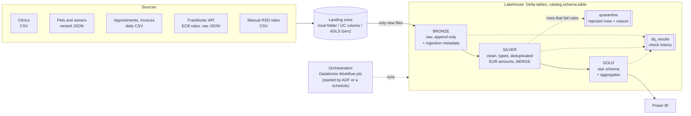
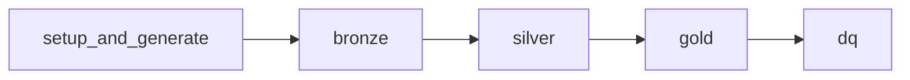
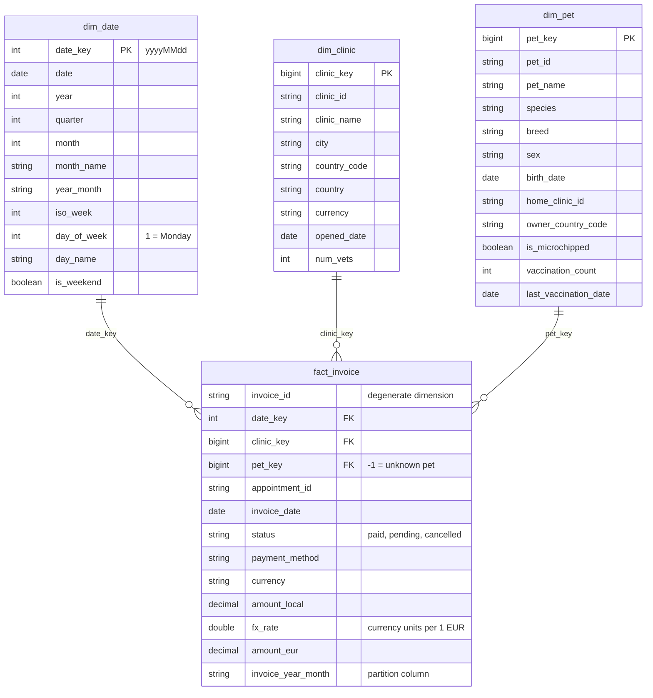
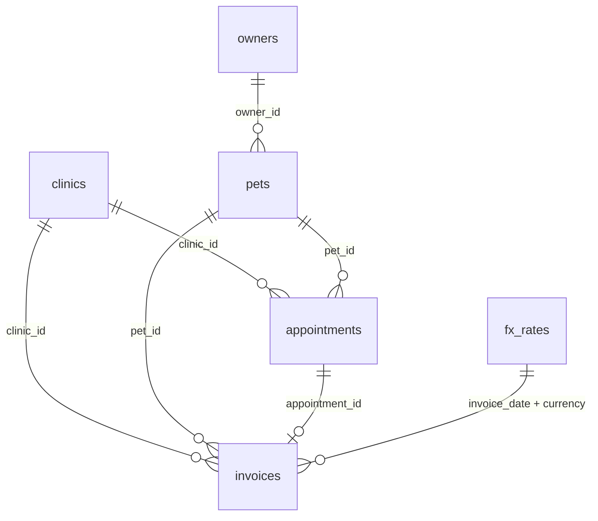
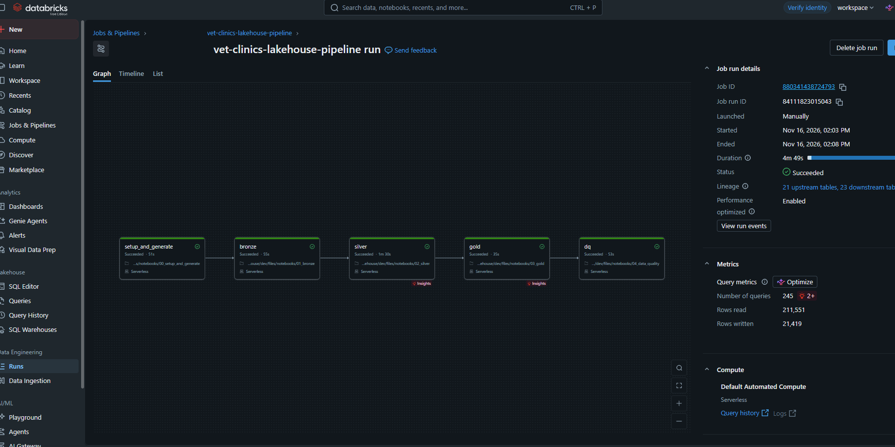
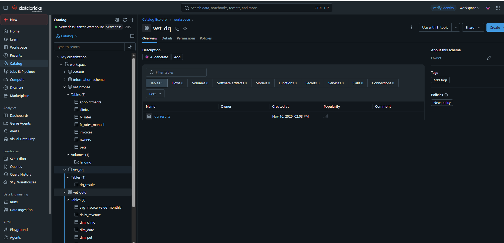
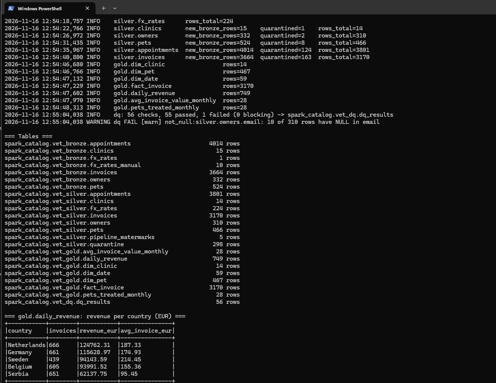

# Vet Clinics Lakehouse

[](https://github.com/milansta6/vet-clinics-lakehouse/actions/workflows/ci.yml)


A production-style **medallion lakehouse (Bronze → Silver → Gold)** built with **PySpark and
Delta Lake**. The same code runs in two places:

- **on a laptop** with one command (`make run`), and
- **on Databricks** (Free Edition works) as a Workflow job deployed with a Databricks Asset Bundle.

**The scenario:** *Lumipaw*, a fictional group of veterinary clinics in Belgium, the
Netherlands, Germany, Sweden and Serbia. Clinics send daily files with appointments and
invoices in three currencies (EUR, SEK, RSD). Management wants one trusted view in Power BI:
revenue per clinic and country in EUR, pets treated per month, and average invoice value.

> All data is **synthetic**. The company, people and pets do not exist. The only real data
> are the public EUR exchange rates of the European Central Bank (via the Frankfurter API).

## What this project shows

| Topic | Where to look |
|---|---|
| Medallion architecture on Delta Lake | [`src/vet_lakehouse/bronze`](src/vet_lakehouse/bronze), [`silver`](src/vet_lakehouse/silver), [`gold`](src/vet_lakehouse/gold) |
| Incremental load (only new files), append-only Bronze with metadata | [`bronze/ingest.py`](src/vet_lakehouse/bronze/ingest.py) |
| Cleaning, typing, deduplication, MERGE (upsert), quarantine | [`silver/transforms.py`](src/vet_lakehouse/silver/transforms.py), [`silver/load.py`](src/vet_lakehouse/silver/load.py) |
| Semi-structured data (nested JSON, arrays, maps) | pets, owners and FX rates in [`bronze/schemas.py`](src/vet_lakehouse/bronze/schemas.py) |
| Currency conversion with real ECB rates, forward-filled for weekends | `build_fx_rates` in [`silver/transforms.py`](src/vet_lakehouse/silver/transforms.py) |
| Star schema and aggregates for Power BI | [`gold/build.py`](src/vet_lakehouse/gold/build.py) |
| Rule-based data quality and reconciliation between layers | [`dq/rules.py`](src/vet_lakehouse/dq/rules.py), [`dq/suite.py`](src/vet_lakehouse/dq/suite.py) |
| Unity Catalog style names (`catalog.schema.table`), configurable | [`config.py`](src/vet_lakehouse/config.py) |
| Databricks Asset Bundle with a Workflow job | [`databricks.yml`](databricks.yml), [`resources/`](resources), [`notebooks/`](notebooks) |
| Orchestration from Azure Data Factory (template) | [`adf/`](adf) |
| Infrastructure as code for Azure (example) | [`infra/`](infra) |
| Partitioning, OPTIMIZE, Z-ORDER, cost choices | [`docs/performance-and-cost.md`](docs/performance-and-cost.md) |
| Unit tests, end-to-end test, CI | [`tests/`](tests), [`.github/workflows/ci.yml`](.github/workflows/ci.yml) |

## Architecture



## The medallion flow

| Layer | What happens | Main tables |
|---|---|---|
| **Bronze** | Files are loaded **as they are**. Every value stays a string, nested JSON keeps its structure. Tables are append-only. Each row gets `_ingested_at`, `_source_file` and `_batch_id`. A run only reads files that are not loaded yet. | `clinics`, `owners`, `pets`, `appointments`, `invoices`, `fx_rates`, `fx_rates_manual` |
| **Silver** | Only new Bronze rows are processed (watermark). Values are trimmed, typed and standardised; nested JSON is flattened; invoice amounts are converted to EUR. Rows that break a rule go to `quarantine`. The latest version per business key is **MERGEd** into the table. | `clinics`, `owners`, `pets`, `appointments`, `invoices`, `fx_rates`, `quarantine`, `pipeline_watermarks` |
| **Gold** | Tables shaped for reporting: a star schema and three small aggregate tables. | `fact_invoice`, `dim_date`, `dim_clinic`, `dim_pet`, `daily_revenue`, `pets_treated_monthly`, `avg_invoice_value_monthly` |
| **DQ** | 56 checks run on Silver and Gold, plus reconciliation between all layers. Results are appended to a table. | `dq_results` |

### Dirty data on purpose

The generator plants realistic problems, and the pipeline has to deal with them:

| Problem in the source files | What Silver does |
|---|---|
| Exact duplicate rows; the same record sent again the next day | Deduplicate: keep the latest version per key |
| Invoice sent as `pending`, later sent again as `paid` | MERGE updates the existing row |
| Dates as `31/01/2025` instead of `2025-01-31` | Parsed (both formats are accepted) |
| Amounts with a decimal comma (`123,45`), currency as ` sek`, status as `No-Show` | Standardised |
| Missing currency | Filled from the clinic's currency |
| Missing ids, missing amounts, negative amounts | **Quarantined** |
| Impossible dates (`2025-13-45`) and dates in 1900 or 2099 | **Quarantined** |
| Unknown clinic id (`CL999`) | **Quarantined** |
| No exchange rate on weekends and holidays | Last known rate is reused (forward fill, max 7 days) |
| The ECB has no rate for the Serbian dinar | RSD comes from a second source (a manual weekly CSV) |

The generator counts the rows it breaks, and the end-to-end test checks that the quarantine
table holds **exactly** those rows: not one more, not one less.

## Run it locally

### Option A: Docker (works on Windows, macOS and Linux)

You only need Docker.

```bash
docker build -t vet-lakehouse .
docker run --rm vet-lakehouse            # the full pipeline
docker run --rm vet-lakehouse make test  # the tests
```

### Option B: Python on Linux, macOS or WSL

You need Python 3.10+ and Java 17.

```bash
python -m venv .venv && source .venv/bin/activate
make install
make run
```

> **Windows without Docker:** Spark needs extra Hadoop binaries (`winutils`) to write files on
> Windows. Using Docker or WSL is much easier.

### Useful commands

| Command | What it does |
|---|---|
| `make run` | Fresh start: generate 59 days of data, then bronze → silver → gold → dq |
| `make run-incremental` | Generate 14 more days and run again. Only the new files are loaded |
| `make bronze` / `silver` / `gold` / `dq` | Run one layer |
| `make optimize` | `OPTIMIZE` + `ZORDER BY` on the main tables |
| `make summary` | Print row counts and a few report queries |
| `make test` / `make lint` | pytest / ruff |
| `make tf-validate` | Check the example Terraform code |

Without `make`: `python -m vet_lakehouse.pipeline run --reset` (see `--help` for all options;
`--offline` skips the API call and uses the cached exchange rates).

### What you will see

A full run takes about 90 seconds. Shortened output:

```text
generated appointments files=59  rows=4014  rows_with_hard_dq_problem=124
generated invoices     files=59  rows=3664  rows_with_hard_dq_problem=163
bronze.appointments     new_files=59  rows_appended=4014
bronze.invoices         new_files=59  rows_appended=3664
silver.appointments  new_bronze_rows=4014  quarantined=124  rows_total=3801
silver.invoices      new_bronze_rows=3664  quarantined=163  rows_total=3170
gold.fact_invoice               rows=3170
gold.daily_revenue              rows=749
dq: 56 checks, 55 passed, 1 failed (0 blocking) -> spark_catalog.vet_dq.dq_results
dq FAIL [warn] not_null:silver.owners.email: 10 of 310 rows have NULL in email

=== gold.daily_revenue: revenue per country (EUR) ===
+-----------+--------+-----------+---------------+
|country    |invoices|revenue_eur|avg_invoice_eur|
+-----------+--------+-----------+---------------+
|Netherlands|666     |124762.31  |187.33         |
|Germany    |661     |115628.97  |174.93         |
|Sweden     |439     |94143.59   |214.45         |
|Belgium    |605     |93991.52   |155.36         |
|Serbia     |651     |62137.75   |95.45          |
+-----------+--------+-----------+---------------+
```

Then `make run-incremental` shows the incremental load: the dimensions are skipped and only
the 14 new daily files are read.

```text
bronze.clinics          new_files=0   rows_appended=0
bronze.pets             new_files=0   rows_appended=0
bronze.appointments     new_files=14  rows_appended=931
bronze.invoices         new_files=14  rows_appended=859
silver.pets          new_bronze_rows=0     quarantined=0    rows_total=466
silver.invoices      new_bronze_rows=859   quarantined=28   rows_total=3913
```

(Exact revenue numbers can differ by a few cents if the ECB corrects a historic rate.)

## Run it on Databricks

Tested on **Databricks Free Edition** (serverless compute, Unity Catalog, default catalog
`workspace`): the job below ran green in under 5 minutes, see [Screenshots](#screenshots).
The same bundle also fits a normal Azure Databricks workspace.

1. Install the [Databricks CLI](https://docs.databricks.com/dev-tools/cli/install.html) and log in:
   ```bash
   databricks auth login --host https://<your-workspace>.cloud.databricks.com
   ```
2. Deploy the bundle (notebooks, the `src/` package and the job) and start the job:
   ```bash
   databricks bundle validate
   databricks bundle deploy
   databricks bundle run vet_lakehouse_pipeline
   ```
3. Open **Jobs & Pipelines** in the workspace to follow the run:



**Configuration.** Table names are always `catalog.schema.table`. Change them without touching code:

```bash
databricks bundle deploy --var="catalog=main" --var="schema_prefix=vet_demo"
```

| Setting | Local default | Databricks default |
|---|---|---|
| Catalog | `spark_catalog` | `workspace` |
| Schemas | `vet_bronze`, `vet_silver`, `vet_gold`, `vet_dq` | the same |
| Landing zone | `.lakehouse/landing/` | Volume `/Volumes/<catalog>/vet_bronze/landing` |
| Compute | local Spark | serverless (no cluster in the job definition) |

**How the notebooks are built.** The notebooks in [`notebooks/`](notebooks) are thin: they read
the widgets, call the same Python functions the local run uses (`run_bronze`, `run_silver`, ...)
and display a few result queries. All logic lives in `src/vet_lakehouse`, where it is unit
tested. [`05_maintenance`](notebooks/05_maintenance.py) (OPTIMIZE, Z-ORDER, VACUUM) is separate
and not part of the daily job.

**To see the incremental load on Databricks:** run the job, then run it again with the job
parameter `days` set to `73`.

**Internet access.** If the workspace cannot reach the Frankfurter API, the setup notebook
falls back to the cached rates in [`data/sample/`](data/sample) automatically.

## Data model

### Gold star schema



- **Grain of the fact table:** one row per invoice.
- **Surrogate keys** are a hash of the business key (`xxhash64`). They do not change when
  Gold is rebuilt, so Power BI relationships stay valid.
- **Dimensions are type 1** (current values only). History (SCD type 2) is on the "next" list.
- **Unknown member:** an invoice for a pet that is not in `dim_pet` points to key `-1`
  instead of being dropped, so revenue totals stay complete.
- **No personal data in Gold:** only the owner's country reaches `dim_pet`. Names, emails and
  addresses stay in Silver.

### Gold aggregates (ready for simple visuals)

| Table | Grain | Measures |
|---|---|---|
| `daily_revenue` | day × clinic (with city and country) | `invoice_count`, `revenue_eur`, `avg_invoice_value_eur` |
| `pets_treated_monthly` | month × clinic | `pets_treated` (distinct pets), `completed_appointments` |
| `avg_invoice_value_monthly` | month × country × clinic | `invoice_count`, `revenue_eur`, `avg_invoice_value_eur`, `max_invoice_value_eur` |

Cancelled invoices are kept in the fact table but are not counted as revenue.

### Silver



Every Silver table keeps `_source_file`, `_batch_id` and `_ingested_at`, so each row can be
traced back to the file it came from.

## Data quality approach

Quality is handled in two places.

**1. Row level, inside Silver: stop bad rows.** Each transformation defines rules such as
`amount_not_negative` or `clinic_id_known`. A row that breaks a rule is not loaded. It goes to
`vet_silver.quarantine` with the names of the failed rules and the original record as JSON.
An example row:

```text
source_table  record_key          failed_rules             raw_record
invoices      INV-20250107-0031   [amount_not_negative]    {"invoice_id":"INV-20250107-0031","amount":"-84.10",...}
```

Nothing is silently dropped, and a fixed record can simply be sent again.

**2. Table level, after Gold: prove the result.** A small rule module
([`dq/rules.py`](src/vet_lakehouse/dq/rules.py)) with five generic checks:

| Rule | Example in this project |
|---|---|
| `not_null` | `silver.invoices.amount_eur` is never NULL |
| `unique` | one row per `invoice_id`; one rate per day and currency |
| `range` | `amount_eur` between 0 and 50,000; share of quarantined rows below 10% |
| `referential_integrity` | every `fact_invoice.clinic_key` exists in `dim_clinic` |
| `reconciliation` | see below |

**Reconciliation between layers**

| From → to | Check |
|---|---|
| Bronze → Silver | Every business key in Bronze is in Silver **or** in quarantine (no record is lost) |
| Bronze → Silver | Every Bronze row without a key is in quarantine |
| Silver → Gold | Same number of invoices in `silver.invoices` and `gold.fact_invoice` |
| Silver → Gold | Same EUR total in `silver.invoices` and `gold.fact_invoice` |
| Gold → Gold | Revenue and invoice count in the fact table match `daily_revenue` and `avg_invoice_value_monthly` |

Each check has a **severity**. A failed `error` check fails the pipeline run (the job task
ends red, and ADF sees the failure). A failed `warn` check is only reported, for example
owners without an email address.

All results are appended to `vet_dq.dq_results` with a run id and timestamp, so quality can
be followed over time:

```sql
SELECT run_at, status, severity, check_name, failed_count, total_count, details
FROM vet_dq.dq_results
ORDER BY run_at DESC, status;
```

## Orchestration

- **Databricks Workflow job** ([`resources/vet_lakehouse_job.yml`](resources/vet_lakehouse_job.yml)):
  owns the task order inside the lakehouse. Includes a daily schedule that is paused by default.
- **Azure Data Factory** ([`adf/`](adf)): an example pipeline that starts the job through the
  Jobs REST API with a managed identity, waits for the result and fails if the job fails.
  **It is a template and was not deployed.**

## Infrastructure as code

[`infra/`](infra) contains a small Terraform configuration for a resource group, an ADLS Gen2
storage account and a Databricks workspace (plus the managed identity that Unity Catalog
needs). **It is example code and was never applied.** It passes `terraform fmt` and
`terraform validate`, and CI checks that on every push.

## Performance and cost

See [`docs/performance-and-cost.md`](docs/performance-and-cost.md) for the choices on
incremental processing, partitioning, OPTIMIZE / Z-ORDER, compute and storage, written in
plain language.

## Project structure

```text
vet-clinics-lakehouse/
├── src/vet_lakehouse/
│   ├── config.py            # catalog / schema / landing path settings
│   ├── spark.py             # Spark session (local Delta session or Databricks)
│   ├── tables.py            # append, overwrite, MERGE helpers
│   ├── generate/            # synthetic data + Frankfurter FX rates
│   ├── bronze/              # schemas and incremental ingestion
│   ├── silver/              # transformations, MERGE loader, quarantine
│   ├── gold/                # star schema and aggregates
│   ├── dq/                  # generic rules and this project's check suite
│   ├── maintenance.py       # OPTIMIZE / Z-ORDER
│   └── pipeline.py          # command line entry point
├── notebooks/               # Databricks notebooks (one per job task)
├── resources/               # Workflow job definition (Asset Bundle)
├── databricks.yml           # Databricks Asset Bundle
├── adf/                     # Azure Data Factory pipeline (template)
├── infra/                   # Terraform (example)
├── data/sample/             # cached FX rates for offline runs and tests
├── docs/                    # performance and cost notes, screenshots
├── tests/                   # pytest: unit tests and one end-to-end test
├── .github/workflows/ci.yml # lint, tests, pipeline smoke test, terraform validate
├── Dockerfile, Makefile, pyproject.toml, requirements*.txt
```

## Tests and CI

- **67 tests** with small fixtures: generator, FX ingestion (the API is mocked), every Silver
  transformation, MERGE, incremental Bronze load, Gold builders and every DQ rule.
- **One end-to-end test** runs the whole pipeline twice on a small data set and checks the
  quarantine counts, the reconciliation and the incremental behaviour.
- **GitHub Actions** runs on every push: `ruff` (lint and format), `pytest`, a full offline
  pipeline run including an incremental run, and `terraform fmt` / `validate`.

## Screenshots

### Databricks Workflow job (Free Edition, serverless)

All five tasks succeeded in 4 min 49 s. The run produced the same row counts as the local run.



### Unity Catalog: schemas and tables



### Local run (`docker run --rm vet-lakehouse`)



### Still to add

- Power BI model view with the star schema (`docs/screenshots/06-power-bi-model.png`)
- Power BI report page (`docs/screenshots/07-power-bi-report.png`)

## What I would do next

1. **Auto Loader and streaming tables** for Bronze on Databricks, instead of listing files.
2. **Lakeflow Declarative Pipelines (DLT)** with expectations, to compare with this
   hand-written version of incremental loads and quarantine.
3. **SCD type 2** for `dim_clinic` and `dim_pet`, so reports can show history
   (for example a pet that moves to another clinic).
4. **Incremental Gold** (only recalculate changed days) and **liquid clustering** instead of
   partitions + Z-ORDER.
5. **Unity Catalog governance**: grants per layer, column masks for owner contact details,
   tags for personal data, and lineage.
6. **Alerting**: a Databricks SQL alert on `dq_results` and on the quarantine share.
7. **CI/CD for the bundle**: deploy to a dev target on pull requests and to prod on merge,
   using a service principal.
8. **Schema drift handling**: rescued data column and schema evolution rules for new columns.
9. **A Power BI report** on the Gold layer, stored as a `.pbip` project in this repo.

## License

[MIT](LICENSE). Synthetic data only; any similarity to real companies, people or animals is
a coincidence. Exchange rates: European Central Bank, via the free
[Frankfurter API](https://frankfurter.dev).
