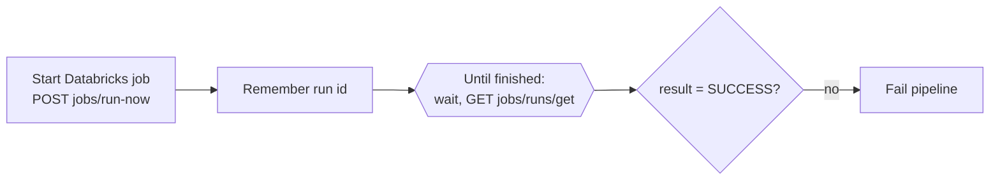

# Azure Data Factory pipeline (template)

> **This is a template.** It was written by hand to show how the Databricks job would be
> orchestrated from Azure Data Factory. It has not been deployed to a real data factory.
> Replace the placeholder workspace URL and job id before using it.

## What it does

`pl_run_vet_lakehouse_job.json` is an ADF pipeline with four steps:

1. **Start Databricks job**: calls the Jobs API (`/api/2.1/jobs/run-now`) and passes
   `catalog` and `schema_prefix` as job parameters. The ADF run id is sent as
   `idempotency_token`, so a retry of the activity does not start a second job run.
2. **Remember run id**: stores the `run_id` from the answer.
3. **Wait for job run**: polls the run status every 60 seconds until it is finished.
4. **Job succeeded?**: if the result is not `SUCCESS`, the ADF pipeline fails, so alerts and
   downstream dependencies work as expected.

## Why ADF and a Databricks job together?

The Databricks Workflow job (see `resources/vet_lakehouse_job.yml`) owns the order of the tasks
inside the lakehouse: bronze, silver, gold, dq. ADF is the outer scheduler: it can first copy
files from source systems (SFTP, SQL Server, APIs) into ADLS Gen2 and then start the job.
This keeps one clear owner for each part and avoids rebuilding the task graph in two tools.

## How to use it

1. Give the data factory's **managed identity** access to the Databricks workspace
   (add it as a service principal and grant *Can Manage Run* on the job).
2. Import the JSON: ADF Studio → Author → Pipelines → `+` → *Import from pipeline template*,
   or deploy it with the ADF Git integration / an ARM or Terraform deployment.
3. Set the parameters `databricksWorkspaceUrl` and `databricksJobId`
   (the job id is printed by `databricks bundle summary`).
4. Add a schedule trigger, or a storage event trigger that fires when new files arrive.

## Notes

- No secrets are stored: authentication uses the managed identity (`MSI`) with the Azure
  Databricks resource id `2ff814a6-3304-4ab8-85cb-cd0e6f879c1d`.
- Newer versions of ADF also have a built-in **Databricks Job** activity that does the same
  with less configuration. The REST version is shown here because it works everywhere and
  makes every step visible.
