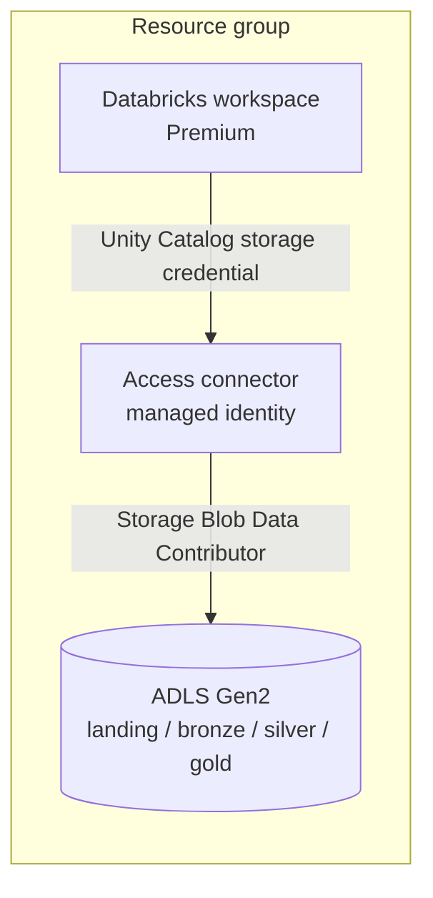

# Infrastructure (example Terraform)

> **This is example IaC.** It has **not** been applied to a real Azure subscription.
> It is checked with `terraform fmt` and `terraform validate` only. Applying it creates
> resources that cost money (the Databricks Premium workspace in particular).

## What it would create

| Resource | Name pattern | Why |
|---|---|---|
| Resource group | `rg-vetlake-dev` | One container for everything, easy to delete |
| Storage account (ADLS Gen2) | `stvetlakedev<random>` | The data lake. Hierarchical namespace on, public access off, access keys off |
| Containers | `landing`, `bronze`, `silver`, `gold` | One per zone, so access can be granted per layer |
| Lifecycle policy | `landing-to-cool-then-delete` | Raw files move to the cool tier after 30 days and are deleted after 1 year |
| Databricks workspace | `dbw-vetlake-dev` | Premium tier (needed for Unity Catalog) |
| Access connector | `dbac-vetlake-dev` | Managed identity that Unity Catalog uses to reach the lake |
| Role assignment | Storage Blob Data Contributor | Gives that identity read/write on the lake (no keys or secrets) |



## Check it (no Azure login needed)

```bash
cd infra
terraform fmt -check -recursive
terraform init -backend=false
terraform validate
```

Or from the repo root: `make tf-validate`.

## If you really want to apply it

```bash
az login
cp terraform.tfvars.example terraform.tfvars   # set your subscription id
terraform init
terraform plan
terraform apply
terraform destroy                              # when you are done
```

## What is left out on purpose

To keep the example small, these production topics are not included:

- Remote state (an `azurerm` backend with state locking)
- Unity Catalog objects (metastore assignment, storage credential, external locations,
  catalogs and grants) with the `databricks` provider
- Private networking (VNet injection, private endpoints, storage firewall)
- Key Vault, diagnostic settings / Log Analytics, budgets and cost alerts
- Azure Data Factory itself (the pipeline template is in `../adf`)
